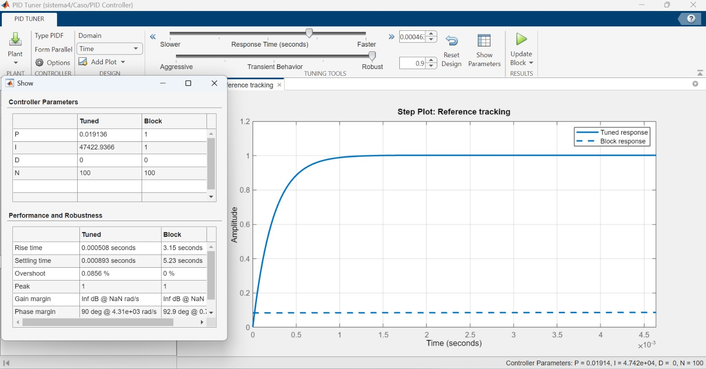

[](https://matlab.mathworks.com/open/github/v1?repo=l23212219-bot/MSFP3)

# Práctica 3 — Modelado y control del sistema musculoesquelético

Repositorio académico de la asignatura **Modelado de Sistemas Fisiológicos**, correspondiente al programa de **Ingeniería Biomédica** del Tecnológico Nacional de México / Instituto Tecnológico de Tijuana.

En esta práctica se trabaja con un modelo del **sistema musculoesquelético**, comparando la respuesta de un sistema de control y un caso de estudio mediante funciones de transferencia de primer orden. Posteriormente se implementa un **controlador PI** como tratamiento para modificar la respuesta del caso y acercarla al comportamiento del sistema de control. La práctica se desarrolla mediante **MATLAB, Simulink y Python**.

**Docente:** Dr. Paul Antonio Valle Trujillo  
**Correo:** paul.valle@tectijuana.edu.mx  
**Departamento:** Ingeniería Eléctrica y Electrónica  
**Institución:** Tecnológico Nacional de México / Instituto Tecnológico de Tijuana  
**Asignatura:** Modelado de Sistemas Fisiológicos  
**Programa:** Ingeniería Biomédica  
**Estudiante:** Navarro Rodriguez Sergio Andree  
**Número de control:** 23212219  
**Correo institucional:** l23212219@tijuana.tecnm.edu.mx  

**Repositorio de la asignatura:** https://github.com/DrPaulValle/MSF-IBF1020  
**Repositorio de esta práctica:** https://github.com/l23212219-bot/MSFP3  
**Sede:** Blvd. Alberto Limón Padilla s/n, C. P. 22454, Tijuana, B. C., México.

---

<a id="contenido"></a>
## Contenido

1. [Resumen](#resumen)
2. [Objetivos](#objetivos)
3. [Representación del sistema](#representacion)
4. [Modelo matemático](#modelo)
5. [Controlador PI](#controlador)
6. [Condiciones de simulación](#simulacion)
7. [Implementación en MATLAB y Simulink](#matlab)
8. [Implementación en Python](#python)
9. [Resultados](#resultados)
10. [Estructura del repositorio](#estructura)
11. [Requisitos](#requisitos)
12. [Reproducción de la práctica](#reproduccion)
13. [Conclusiones](#conclusiones)
14. [Referencias](#referencias)

---

<a id="resumen"></a>
## Resumen

La práctica consiste en modelar y simular un **sistema musculoesquelético** a partir de dos funciones de transferencia: una correspondiente al **sistema de control** y otra al **caso de estudio**. Ambos modelos reciben una señal de fuerza de entrada \(F(t)\), y sus respuestas se comparan para observar las diferencias entre ellos.

Después se aplica un **controlador PI** al modelo del caso. La finalidad del tratamiento es modificar su respuesta para aproximarla a la salida obtenida con el sistema de control.

La simulación se reproduce tanto en **MATLAB/Simulink** como en **Python**, permitiendo comparar los resultados obtenidos con ambas herramientas.

**Palabras clave:** sistema musculoesquelético; modelado fisiológico; función de transferencia; controlador PI; MATLAB; Simulink; Python; control automático.

[Volver al contenido](#contenido)

---

<a id="objetivos"></a>
## Objetivos

### Objetivo general

Modelar y analizar la respuesta de un sistema musculoesquelético mediante funciones de transferencia, comparando un sistema de control con un caso de estudio e implementando un controlador PI como tratamiento.

### Objetivos específicos

- Representar matemáticamente el sistema de control y el caso mediante funciones de transferencia.
- Aplicar una señal de fuerza de entrada a ambos sistemas.
- Comparar las respuestas del sistema de control y del caso.
- Implementar un controlador PI sobre el modelo del caso.
- Analizar el efecto del tratamiento sobre la respuesta del sistema.
- Reproducir la simulación mediante MATLAB, Simulink y Python.
- Comparar los resultados generados con las diferentes herramientas.
- Organizar los modelos, códigos, gráficas y análisis dentro del repositorio.

[Volver al contenido](#contenido)

---

<a id="representacion"></a>
## Representación del sistema

La representación gráfica utilizada para la práctica se encuentra en el archivo:


Los parámetros utilizados en el modelo también se incluyen como evidencia dentro del repositorio:



La simulación considera cuatro señales principales:

| Señal | Descripción |
|---|---|
| \(F(t)\) | Fuerza o señal de entrada aplicada al modelo |
| \(F_s(t)\): Control | Respuesta del sistema de control |
| \(F_s(t)\): Caso | Respuesta del caso de estudio |
| Tratamiento | Respuesta del caso después de aplicar el controlador PI |

[Volver al contenido](#contenido)

---

<a id="modelo"></a>
## Modelo matemático

### Sistema de control

La función de transferencia utilizada para representar el sistema de control es:

\[
G_{control}(s)=\frac{0.001s+0.75}{0.011s+1}
\]

### Caso de estudio

La función de transferencia correspondiente al caso es:

\[
G_{caso}(s)=\frac{0.1s+0.75}{1.1s+1}
\]

Las dos funciones tienen una ganancia y una dinámica diferentes, por lo que producen respuestas distintas ante la misma entrada.

El objetivo del control es tomar el comportamiento del sistema de control como referencia y modificar la respuesta del caso mediante el tratamiento.

[Volver al contenido](#contenido)

---

<a id="controlador"></a>
## Controlador PI

Para el tratamiento se utiliza un controlador proporcional-integral:

\[
C(s)=K_P+\frac{K_I}{s}
\]

con las ganancias:

| Parámetro | Valor |
|---|---:|
| \(K_P\) | 0.019136 |
| \(K_I\) | 47422.9366 |

Por lo tanto:

\[
C(s)=0.019136+\frac{47422.9366}{s}
\]

El sistema tratado se obtiene mediante retroalimentación negativa unitaria:

\[
T(s)=\frac{C(s)G_{caso}(s)}{1+C(s)G_{caso}(s)}
\]

> **Nota:** en algunos nombres de variables y etiquetas del código se utiliza la palabra `PID`, pero el controlador implementado en esta práctica es un **PI**, ya que únicamente se emplean las ganancias \(K_P\) y \(K_I\).

[Volver al contenido](#contenido)

---

<a id="simulacion"></a>
## Condiciones de simulación

En la implementación de Python se utiliza:

| Parámetro | Valor |
|---|---:|
| Tiempo inicial | \(0\,s\) |
| Tiempo final | \(10\,s\) |
| Paso de tiempo | \(1\times10^{-3}\,s\) |
| Condición inicial | 0 |
| Amplitud de la entrada | 1 |

La entrada se genera como un pulso:

\[
F(t)=
\begin{cases}
1, & 1\leq t<2\\
0, & \text{en otro caso}
\end{cases}
\]

Esta señal se utiliza para observar y comparar la respuesta temporal de los modelos.

[Volver al contenido](#contenido)

---

<a id="matlab"></a>
## Implementación en MATLAB y Simulink

La práctica incluye un **Live Script de MATLAB** y un modelo de **Simulink**.

Archivos principales:

- [`Navarro23212219.mlx`](Navarro23212219.mlx) — Live Script de MATLAB.
- [`Navarro23212219.pdf`](Navarro23212219.pdf) — exportación del Live Script.
- [`unidad4.slx`](unidad4.slx) — modelo desarrollado en Simulink.
- [`musculoesqueletico_matlab.pdf`](musculoesqueletico_matlab.pdf) — gráfica obtenida en MATLAB/Simulink.

El modelo permite representar la entrada, la respuesta del sistema de control, la respuesta del caso y el efecto del tratamiento.

[Volver al contenido](#contenido)

---

<a id="python"></a>
## Implementación en Python

El archivo [`Navarro23212219.py`](Navarro23212219.py) reproduce el modelo utilizando las librerías:

- `NumPy`
- `control`
- `Matplotlib`

El programa realiza las siguientes etapas:

1. Define el vector de tiempo.
2. Genera la señal de entrada \(F(t)\).
3. Define la función de transferencia del sistema de control.
4. Define la función de transferencia del caso.
5. Define las ganancias del controlador PI.
6. Construye el sistema tratado con retroalimentación.
7. Calcula las respuestas mediante `forced_response`.
8. Grafica las cuatro señales para compararlas.
9. Guarda el resultado en formato PDF.

La gráfica generada se almacena como:

[`Musculoesqueletico_python.pdf`](Musculoesqueletico_python.pdf)

[Volver al contenido](#contenido)

---

<a id="resultados"></a>
## Resultados

Los principales archivos de resultados incluidos en el repositorio son:

| Archivo | Descripción |
|---|---|
| [`Analisis-matematico.pdf`](Analisis-matematico.pdf) | Desarrollo y análisis matemático del modelo |
| [`Musculoesqueletico.png`](Musculoesqueletico.png) | Representación gráfica del sistema |
| [`parametros.jpeg`](parametros.jpeg) | Parámetros utilizados en el modelo |
| [`musculoesqueletico_matlab.pdf`](musculoesqueletico_matlab.pdf) | Resultado obtenido en MATLAB/Simulink |
| [`Musculoesqueletico_python.pdf`](Musculoesqueletico_python.pdf) | Resultado reproducido en Python |
| [`Navarro23212219.pdf`](Navarro23212219.pdf) | Evidencia exportada del Live Script |

La comparación principal se realiza entre la señal de entrada, el sistema de control, el caso y la respuesta obtenida después del tratamiento.

El uso de MATLAB/Simulink y Python permite realizar una verificación cruzada del modelo y comprobar que la simulación se puede reproducir con diferentes herramientas computacionales.

[Volver al contenido](#contenido)

---

<a id="estructura"></a>
## Estructura del repositorio

```text
MSFP3/
├── Analisis-matematico.pdf
├── LICENSE
├── Musculoesqueletico.png
├── Musculoesqueletico_python.pdf
├── Navarro23212219.mlx
├── Navarro23212219.pdf
├── Navarro23212219.py
├── README.md
├── musculoesqueletico_matlab.pdf
├── parametros.jpeg
└── unidad4.slx
```

### Descripción de los archivos principales

- **`Navarro23212219.mlx`**: desarrollo principal realizado en MATLAB.
- **`unidad4.slx`**: modelo utilizado para la simulación en Simulink.
- **`Navarro23212219.py`**: reproducción de la simulación en Python.
- **`Analisis-matematico.pdf`**: análisis matemático de la práctica.
- **`Musculoesqueletico.png`**: representación del sistema fisiológico.
- **`parametros.jpeg`**: evidencia de los parámetros utilizados.
- **`musculoesqueletico_matlab.pdf`**: resultado obtenido mediante MATLAB.
- **`Musculoesqueletico_python.pdf`**: resultado obtenido mediante Python.

[Volver al contenido](#contenido)

---

<a id="requisitos"></a>
## Requisitos

### MATLAB

- MATLAB.
- Simulink.
- Herramientas necesarias para trabajar con funciones de transferencia y sistemas de control.

El repositorio puede abrirse directamente mediante el botón **Open in MATLAB Online** colocado al inicio de este README.

### Python

Para ejecutar el archivo de Python se requieren:

```bash
pip install numpy control matplotlib
```

Posteriormente se puede ejecutar:

```bash
python Navarro23212219.py
```

[Volver al contenido](#contenido)

---

<a id="reproduccion"></a>
## Reproducción de la práctica

Para reproducir el trabajo:

1. Descargar o clonar este repositorio.
2. Abrir `Navarro23212219.mlx` en MATLAB.
3. Abrir `unidad4.slx` y verificar las conexiones y parámetros del modelo.
4. Ejecutar la simulación y comparar la entrada, el sistema de control, el caso y el tratamiento.
5. Revisar el resultado de MATLAB en `musculoesqueletico_matlab.pdf`.
6. Ejecutar `Navarro23212219.py`.
7. Comparar el resultado obtenido en Python con `Musculoesqueletico_python.pdf`.
8. Consultar `Analisis-matematico.pdf` para revisar el desarrollo del modelo.

[Volver al contenido](#contenido)

---

<a id="conclusiones"></a>
## Conclusiones

La práctica permitió representar el comportamiento de un sistema musculoesquelético mediante funciones de transferencia y observar las diferencias entre un sistema de control y un caso de estudio.

La incorporación del controlador PI permitió evaluar una estrategia de tratamiento desde el punto de vista del modelado y control de sistemas fisiológicos. Además, la reproducción del modelo mediante MATLAB/Simulink y Python permitió comparar resultados y verificar el funcionamiento de la simulación en dos entornos diferentes.

Este procedimiento integra conceptos de modelado matemático, sistemas de control y simulación computacional dentro de una aplicación relacionada con Ingeniería Biomédica.

[Volver al contenido](#contenido)

---

<a id="referencias"></a>
## Referencias

[1] P. A. Valle Trujillo, material de la asignatura **Modelado de Sistemas Fisiológicos**, Tecnológico Nacional de México / Instituto Tecnológico de Tijuana.

[2] Repositorio general de la asignatura: https://github.com/DrPaulValle/MSF-IBF1020

[3] Repositorio de la práctica: https://github.com/l23212219-bot/MSFP3

---

## Uso académico

Este repositorio se utiliza como evidencia académica de la **Práctica 3: Modelado y control del sistema musculoesquelético** de la asignatura **Modelado de Sistemas Fisiológicos**.

Los archivos incluidos documentan el desarrollo matemático, la simulación en MATLAB/Simulink, la reproducción en Python y los resultados obtenidos durante la práctica.

## Licencia

Este repositorio incluye una licencia **BSD 2-Clause**, disponible en el archivo [`LICENSE`](LICENSE).
