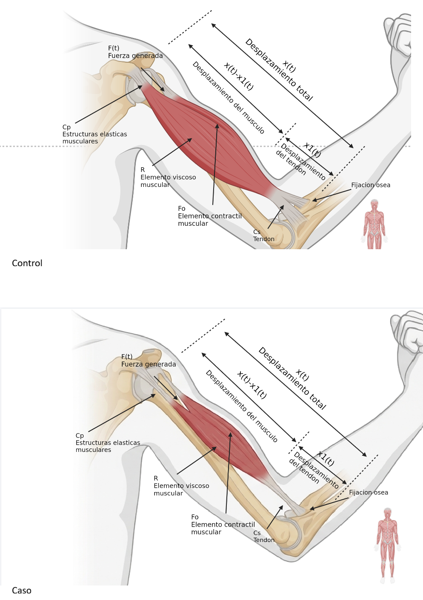

[](https://matlab.mathworks.com/open/github/v1?repo=l23212219-bot/MSFP3)

# Práctica 3 — Modelado y control del sistema musculoesquelético

Repositorio académico de la asignatura **Modelado de Sistemas Fisiológicos**, correspondiente al programa de **Ingeniería Biomédica** del Tecnológico Nacional de México / Instituto Tecnológico de Tijuana.

Esta práctica estudia el comportamiento de un **modelo de control** y un **modelo de caso** del sistema musculoesquelético. Se utilizan funciones de transferencia para comparar sus respuestas ante una misma entrada y se incorpora un **controlador proporcional-integral (PI)** para modificar la respuesta del caso y aproximarla a la del control. El procedimiento se desarrolla mediante análisis matemático, MATLAB/Simulink y Python.

> **Alcance:** los modelos son representaciones matemáticas simplificadas. La comparación entre «control» y «caso» no constituye por sí misma la identificación de una enfermedad ni una evaluación clínica.

---

<a id="contenido"></a>
## Contenido

1. [Resumen](#resumen)
2. [Competencia y objetivos](#objetivos)
3. [Fundamento fisiológico](#fundamento)
4. [Modelo matemático](#modelo)
5. [Análisis del comportamiento](#analisis)
6. [Señal de entrada y simulación](#simulacion)
7. [Controlador PI](#controlador)
8. [Implementación en MATLAB y Simulink](#matlab)
9. [Implementación en Python](#python)
10. [Resultados y comparación](#resultados)
11. [Procedimiento de reproducción](#procedimiento)
12. [Estructura del repositorio](#estructura)
13. [Requisitos](#requisitos)
14. [Conclusiones](#conclusiones)
15. [Referencias](#referencias)

---

<a id="resumen"></a>
## Resumen

El sistema musculoesquelético permite producir movimiento y mantener la postura mediante la interacción de músculos, huesos, articulaciones y mecanismos de control neuromuscular. Su comportamiento puede estudiarse de forma simplificada utilizando modelos dinámicos que describen la relación entre una señal de entrada y una respuesta de salida.

En esta práctica se comparan dos modelos lineales: **control**, utilizado como referencia, y **caso**, cuya dinámica es diferente. Ambos se representan con funciones de transferencia de primer orden. Posteriormente se añade un controlador PI al modelo del caso para observar cómo cambia su respuesta y qué tan cerca se encuentra de la referencia.

La simulación se realiza con una entrada tipo pulso y se representan cuatro señales: la entrada aplicada, la respuesta del control, la respuesta del caso y la respuesta del caso con tratamiento mediante PI. Los resultados se documentan a través de los archivos de MATLAB, Simulink, Python y las figuras incluidas en este repositorio.

**Palabras clave:** sistema musculoesquelético; modelado fisiológico; función de transferencia; sistema de control; controlador PI; retroalimentación negativa; respuesta temporal; MATLAB; Simulink; Python; simulación computacional.

[Volver al contenido](#contenido)

---

<a id="objetivos"></a>
## Competencia y objetivos

### Competencia a desarrollar

Aplicar los conceptos de modelado matemático, análisis de sistemas dinámicos y control retroalimentado para estudiar la respuesta de un sistema fisiológico simplificado mediante herramientas computacionales.

### Objetivo general

**Modelar, simular y comparar** el comportamiento de un sistema musculoesquelético de control y un caso, e implementar un controlador PI que permita aproximar la respuesta del caso a la del control.

### Objetivos específicos

- Identificar la señal de entrada, las respuestas de salida y los parámetros de ambos modelos.
- Expresar los modelos mediante funciones de transferencia y ecuaciones diferenciales.
- Analizar sus polos, ceros, ganancias estáticas y constantes de tiempo.
- Comparar las respuestas del control y del caso ante una entrada tipo pulso.
- Implementar un controlador PI con retroalimentación negativa en el modelo del caso.
- Reproducir y visualizar la simulación mediante MATLAB/Simulink y Python.
- Interpretar las diferencias entre las respuestas obtenidas y documentar los resultados.

[Volver al contenido](#contenido)

---

<a id="fundamento"></a>
## Fundamento fisiológico

El movimiento corporal depende de la coordinación entre músculos, tendones, articulaciones y el sistema nervioso. Las señales de activación muscular producen fuerzas que se transmiten al sistema esquelético y generan desplazamientos o permiten conservar una postura.

Para analizar un sistema de este tipo sin representar todos sus procesos fisiológicos, es posible utilizar un **modelo entrada–salida**. La entrada representa una señal de excitación y la salida describe la respuesta del modelo a lo largo del tiempo. Esta aproximación permite comparar comportamientos dinámicos y estudiar el efecto de un controlador.

En este trabajo se consideran dos condiciones:

| Condición | Función dentro del análisis |
|---|---|
| **Control** | Modelo de referencia con una respuesta dinámica más rápida. |
| **Caso** | Modelo comparativo que presenta una respuesta dinámica más lenta. |
| **Caso con PI** | Modelo del caso al que se aplica un control con retroalimentación para seguir la respuesta de referencia. |

La práctica se centra en las **diferencias de respuesta temporal** entre los modelos. Los coeficientes empleados son los definidos en los archivos de simulación; no se presentan como parámetros fisiológicos medidos directamente en un paciente.

### Diagrama de referencia



[Volver al contenido](#contenido)

---

<a id="modelo"></a>
## Modelo matemático

### 1. Función de transferencia del control

El modelo de referencia se representa mediante:

$$
G_{control}(s)=\frac{0.001s+0.75}{0.011s+1}
$$

### 2. Función de transferencia del caso

El modelo que se desea controlar se expresa como:

$$
G_{caso}(s)=\frac{0.1s+0.75}{1.1s+1}
$$

Ambas funciones de transferencia son de **primer orden**, ya que el mayor exponente de la variable `s` en sus denominadores es uno. En estos modelos, `s` representa la variable compleja de Laplace.

### 3. Relación entrada–salida

De manera general, una función de transferencia relaciona la salida con la entrada bajo condiciones iniciales nulas:

$$
G(s)=\frac{Y(s)}{F(s)}
$$

Aquí, `F(s)` representa la entrada y `Y(s)` la respuesta del modelo en el dominio de Laplace.

Al regresar al dominio del tiempo se obtienen las ecuaciones diferenciales equivalentes.

**Modelo de control:**

$$
0.011\frac{dy_{control}(t)}{dt}+y_{control}(t)
=0.001\frac{dF(t)}{dt}+0.75F(t)
$$

**Modelo del caso:**

$$
1.1\frac{dy_{caso}(t)}{dt}+y_{caso}(t)
=0.1\frac{dF(t)}{dt}+0.75F(t)
$$

Estas expresiones permiten observar que, aun cuando ambos sistemas reciben la misma entrada, sus coeficientes modifican la rapidez con la que responden.

### 4. Parámetros de los modelos

| Parámetro | Control | Caso |
|---|---:|---:|
| Coeficiente de `s` en el numerador | 0.001 | 0.1 |
| Término constante del numerador | 0.75 | 0.75 |
| Coeficiente de `s` en el denominador | 0.011 | 1.1 |
| Término constante del denominador | 1 | 1 |
| Ganancia estática | 0.75 | 0.75 |
| Constante de tiempo del denominador | 0.011 s | 1.1 s |

Los parámetros originales utilizados para las simulaciones también pueden consultarse en [`parametros.jpeg`](parametros.jpeg).

[Volver al contenido](#contenido)

---

<a id="analisis"></a>
## Análisis del comportamiento

### 1. Ganancia estática

La ganancia estática se obtiene evaluando cada función de transferencia en `s = 0`:

$$
G(0)=\frac{0.75}{1}=0.75
$$

Por lo tanto, **ambos modelos tienen la misma ganancia estática**. Si se aplicara un escalón unitario de duración indefinida, las dos salidas tenderían al mismo valor de 0.75, aunque llegarían a él con velocidades diferentes.

### 2. Polos y estabilidad

Los polos son los valores de `s` que hacen cero el denominador de la función de transferencia.

**Control:**

$$
s_{control}=-\frac{1}{0.011}\approx-90.91
$$

**Caso:**

$$
s_{caso}=-\frac{1}{1.1}\approx-0.91
$$

Los dos polos son negativos. Por ello, ambos modelos son **estables en lazo abierto**.

### 3. Constantes de tiempo

Las constantes de tiempo asociadas con los denominadores son:

$$
\tau_{control}=0.011\ \mathrm{s}
$$

$$
\tau_{caso}=1.1\ \mathrm{s}
$$

La constante de tiempo del caso es **100 veces mayor** que la del control. Esto indica que el caso presenta una dinámica mucho más lenta. La comparación se refiere a la rapidez característica de estos modelos, no a una medición directa de velocidad muscular.

### 4. Interpretación de la respuesta

Ante una entrada de duración limitada, se espera que el modelo de control responda y regrese más rápidamente hacia su estado inicial. El modelo del caso presenta cambios más lentos, por lo que su respuesta puede mantenerse durante más tiempo después de terminar el pulso.

Esta diferencia justifica incorporar un controlador para estudiar la posibilidad de hacer que el caso siga el comportamiento del control.

[Volver al contenido](#contenido)

---

<a id="simulacion"></a>
## Señal de entrada y condiciones de simulación

En el programa de Python se utiliza una señal tipo **pulso rectangular** con amplitud unitaria.

| Parámetro | Valor |
|---|---|
| Tiempo inicial | 0 s |
| Tiempo final | 10 s |
| Intervalo de muestreo | 0.001 s |
| Número de muestras | 10 001 |
| Amplitud del pulso | 1 |
| Inicio del pulso | 1 s |
| Fin del pulso | 2 s (sin incluirlo) |
| Condición inicial | 0 |

La señal aplicada puede describirse como:

$$
F(t)=\begin{cases}
1, & 1\leq t<2 \\
0, & \text{en otro caso}
\end{cases}
$$

En el código se construye mediante las siguientes instrucciones:

```python
N = round((tend-t0)/dt) + 1
t = np.linspace(t0,tend,N)
F = np.zeros(N)
F[1000:2000] = 1
```

La duración de un segundo permite comparar la rapidez de respuesta de los modelos durante la aplicación de la entrada y después de retirarla.

[Volver al contenido](#contenido)

---

<a id="controlador"></a>
## Controlador PI

### 1. Tipo de controlador empleado

En esta práctica se utiliza un **controlador proporcional-integral (PI)**. La acción proporcional responde al error actual, mientras que la acción integral acumula el error a lo largo del tiempo.

La ecuación del controlador en el dominio del tiempo es:

$$
u(t)=K_p e(t)+K_i\int_0^t e(\tau)\,d\tau
$$

Su función de transferencia es:

$$
C_{PI}(s)=K_p+\frac{K_i}{s}
$$

El controlador implementado **no tiene término derivativo**. Aunque la variable de salida del programa se llama `PID`, la estructura utilizada en el código corresponde específicamente a un controlador PI.

### 2. Ganancias utilizadas

| Ganancia | Valor |
|---|---:|
| Proporcional (`Kp`) | 0.019136 |
| Integral (`Ki`) | 47422.9366 |
| Derivativa (`Kd`) | No se utiliza |

Por sustitución:

$$
C_{PI}(s)=0.019136+\frac{47422.9366}{s}
$$

Estos son los valores presentes en el programa de simulación, no valores calculados a partir de datos clínicos.

### 3. Retroalimentación negativa

El PI se conecta en serie con el modelo del caso y se cierra el lazo mediante una retroalimentación negativa unitaria.

La función de transferencia del sistema controlado es:

$$
T_{PI}(s)=\frac{C_{PI}(s)G_{caso}(s)}{1+C_{PI}(s)G_{caso}(s)}
$$

**Detalle importante de la implementación:** el sistema PI recibe como referencia la **salida del modelo de control**, no directamente el pulso original. De este modo se estudia si la respuesta controlada del caso puede seguir la señal de referencia que produce el modelo de control.

[Volver al contenido](#contenido)

---

<a id="matlab"></a>
## Implementación en MATLAB y Simulink

El análisis computacional se complementa con el cuaderno de MATLAB y el modelo de Simulink incluidos en el repositorio.

| Archivo | Descripción |
|---|---|
| [`Navarro23212219.mlx`](Navarro23212219.mlx) | Cuaderno de MATLAB utilizado para el desarrollo de la práctica. |
| [`unidad4.slx`](unidad4.slx) | Modelo de Simulink para representar y simular el sistema. |
| [`Navarro23212219.pdf`](Navarro23212219.pdf) | Exportación del trabajo desarrollado en MATLAB. |
| [`musculoesqueletico_matlab.pdf`](musculoesqueletico_matlab.pdf) | Figura de resultados generada en MATLAB. |

### Pasos generales

1. Abrir el archivo `.slx` en Simulink.
2. Revisar la señal de entrada, los bloques de transferencia y las conexiones de retroalimentación.
3. Abrir el cuaderno `.mlx` y ejecutar las secciones correspondientes.
4. Verificar las señales del control, del caso y del sistema con controlador.
5. Consultar la gráfica exportada y comparar las respuestas dentro del intervalo de simulación.

La interpretación debe realizarse usando los **parámetros efectivos del modelo abierto**, ya que cualquier modificación de ganancias, bloques o configuración puede cambiar los resultados.

### Figura de MATLAB

[Consultar los resultados en MATLAB (PDF)](musculoesqueletico_matlab.pdf)

[Volver al contenido](#contenido)

---

<a id="python"></a>
## Implementación en Python

El archivo [`Navarro23212219.py`](Navarro23212219.py) reproduce la comparación mediante la biblioteca `python-control` y genera una gráfica de las cuatro señales.

### Bibliotecas utilizadas

```python
import numpy as np
import control as ctrl
import matplotlib.pyplot as plt
```

- **NumPy:** crea el vector temporal y las señales numéricas.
- **python-control:** define las funciones de transferencia, el lazo cerrado y las respuestas forzadas.
- **Matplotlib:** dibuja y exporta la gráfica final.

### Definición de los modelos

```python
siscontrol = ctrl.tf([0.001,0.75],[0.011,1])
siscaso = ctrl.tf([0.1,0.75],[1.1,1])
```

### Implementación del PI

```python
Kp = 0.019136
Ki = 47422.9366
PI = ctrl.tf([Kp,Ki],[1,0])
sisPID = ctrl.feedback(ctrl.series(PI,siscaso),1)
```

### Cálculo de las respuestas

```python
_,Fsx = ctrl.forced_response(siscontrol,t,F,x0)
_,FsY = ctrl.forced_response(siscaso,t,F,x0)
_,PID = ctrl.forced_response(sisPID,t,Fsx,x0)
```

La tercera instrucción usa `Fsx`, es decir, la salida del modelo de control, como entrada de referencia del sistema con PI.

### Señales representadas

| Señal en el código | Leyenda de la gráfica | Interpretación |
|---|---|---|
| `F` | `F(t)` | Pulso aplicado. |
| `Fsx` | `Fs(t): Control` | Respuesta del modelo de control. |
| `FsY` | `Fs(t): Caso` | Respuesta del modelo del caso. |
| `PID` | `PID: Tratamiento` | Respuesta del caso con controlador PI. |

El programa exporta el resultado como [`Musculoesqueletico_python.pdf`](Musculoesqueletico_python.pdf).

**Nota sobre unidades:** la gráfica del script utiliza voltios (`V`) en su eje vertical. Esto corresponde a la representación de la simulación; no debe interpretarse automáticamente como una medición directa de fuerza en newtons o de actividad muscular.

[Volver al contenido](#contenido)

---

<a id="resultados"></a>
## Resultados y comparación

La comparación se basa en las respuestas obtenidas con la misma entrada tipo pulso y en el comportamiento del caso antes y después de incorporar el controlador.

### Resultados disponibles

| Evidencia | Archivo |
|---|---|
| Análisis matemático | [`Analisis-matematico.pdf`](Analisis-matematico.pdf) |
| Gráfica de MATLAB | [`musculoesqueletico_matlab.pdf`](musculoesqueletico_matlab.pdf) |
| Gráfica de Python | [`Musculoesqueletico_python.pdf`](Musculoesqueletico_python.pdf) |
| Exportación del cuaderno | [`Navarro23212219.pdf`](Navarro23212219.pdf) |
| Representación gráfica del sistema | [`Musculoesqueletico.png`](Musculoesqueletico.png) |
| Parámetros de referencia | [`parametros.jpeg`](parametros.jpeg) |

### Interpretación de los resultados

**Modelo de control.** Presenta una constante de tiempo pequeña, por lo que su respuesta a los cambios de entrada es rápida. Se utiliza como referencia para evaluar el comportamiento deseado.

**Modelo del caso.** Su constante de tiempo es considerablemente mayor, lo que produce una respuesta más lenta. Aunque ambos modelos comparten la misma ganancia estática, su comportamiento durante el pulso y al finalizarlo es diferente.

**Modelo del caso con PI.** La retroalimentación permite corregir la diferencia entre la referencia producida por el control y la respuesta del caso. El controlador busca reducir el error de seguimiento y modificar la dinámica de la respuesta.

**Comparación entre MATLAB y Python.** Las dos herramientas permiten visualizar el comportamiento del sistema. Al comparar los resultados, es importante revisar que se hayan empleado las mismas funciones de transferencia, ganancias, señales y condiciones iniciales. No debe suponerse que las gráficas son idénticas si los modelos o ajustes utilizados son diferentes.

### Alcances y limitaciones

- El análisis utiliza modelos lineales simplificados; el comportamiento de un sistema musculoesquelético real es más complejo.
- La diferencia entre control y caso se establece mediante coeficientes matemáticos, no a partir de una identificación clínica documentada.
- Los resultados corresponden a **simulaciones computacionales**, no a mediciones experimentales directas.
- El controlador PI representa una estrategia de seguimiento de referencia y no un tratamiento médico validado.

[Volver al contenido](#contenido)

---

<a id="procedimiento"></a>
## Procedimiento de reproducción

1. Revisar las funciones de transferencia en el [análisis matemático](Analisis-matematico.pdf).
2. Abrir [`unidad4.slx`](unidad4.slx) en Simulink y verificar la configuración del sistema.
3. Ejecutar [`Navarro23212219.mlx`](Navarro23212219.mlx) en MATLAB y consultar la gráfica exportada.
4. Instalar las bibliotecas necesarias en Python, si aún no están disponibles.
5. Ejecutar [`Navarro23212219.py`](Navarro23212219.py).
6. Revisar las cuatro curvas generadas y el archivo `Musculoesqueletico_python.pdf`.
7. Comparar la respuesta del control, del caso y del caso con PI, tomando en cuenta sus parámetros y las condiciones de cada simulación.

### Instalación de bibliotecas de Python

```bash
python -m pip install numpy matplotlib control
```

### Ejecución del programa

```bash
python Navarro23212219.py
```

El script genera una gráfica en pantalla y guarda el PDF en el directorio desde el que se ejecuta. Si ya existe un archivo con el mismo nombre en esa ubicación, la ejecución puede sobrescribirlo.

[Volver al contenido](#contenido)

---

<a id="estructura"></a>
## Estructura del repositorio

Los archivos publicados se organizan de la siguiente manera:

```text
MSFP3/
├── README.md
├── LICENSE
├── Analisis-matematico.pdf
├── Musculoesqueletico.png
├── Musculoesqueletico_python.pdf
├── Navarro23212219.mlx
├── Navarro23212219.pdf
├── Navarro23212219.py
├── musculoesqueletico_matlab.pdf
├── parametros.jpeg
└── unidad4.slx
```

Se conservan los nombres reales de los archivos para que los enlaces del README lleven directamente a los documentos y resultados correspondientes.

[Volver al contenido](#contenido)

---

<a id="requisitos"></a>
## Requisitos

### MATLAB y Simulink

- MATLAB para abrir y ejecutar el cuaderno `.mlx`.
- Simulink para abrir el archivo `.slx`.
- Herramientas de análisis de sistemas de control necesarias para trabajar con las funciones de transferencia y el controlador.

### Python

- Python 3.
- NumPy.
- Matplotlib.
- Biblioteca `control` (`python-control`).

También puede utilizarse **Visual Studio Code** como editor para ejecutar el script de Python. No se especifica una versión mínima del software dentro del código revisado.

[Volver al contenido](#contenido)

---

<a id="conclusiones"></a>
## Conclusiones

El modelado matemático permitió comparar dos respuestas diferentes del sistema musculoesquelético a partir de funciones de transferencia de primer orden. El análisis de las constantes de tiempo muestra que el modelo del caso responde más lentamente que el control, aunque ambos tienen la misma ganancia estática.

La incorporación de un **controlador PI** permite estudiar una estrategia de retroalimentación para que el caso siga la respuesta del control. Las simulaciones en MATLAB/Simulink y Python ayudan a observar estas diferencias en el dominio del tiempo y a relacionar los resultados con las características de cada modelo.

La práctica demuestra la utilidad de las herramientas de modelado y control para estudiar sistemas fisiológicos de forma simplificada, reconociendo que una simulación matemática no sustituye la validación experimental ni la evaluación clínica.

[Volver al contenido](#contenido)

---

<a id="referencias"></a>
## Referencias

[1] M. C. K. Khoo, *Physiological Control Systems: Analysis, Simulation, and Estimation*, 2.ª ed., IEEE Press/Wiley, 2018.

[2] J. E. Hall, *Guyton and Hall Textbook of Medical Physiology*, 14.ª ed., Elsevier, 2021.

[3] K. Ogata, *Ingeniería de control moderna*, 5.ª ed., Pearson, 2010.

[4] N. S. Nise, *Control Systems Engineering*, 8.ª ed., Wiley, 2020.

[5] MathWorks, *Documentación de Control System Toolbox*. Disponible en: https://www.mathworks.com/help/control/

[6] Python Control Systems Library, *Documentación oficial*. Disponible en: https://python-control.readthedocs.io/

---

## Uso académico

Este repositorio documenta una práctica de **Modelado de Sistemas Fisiológicos** enfocada en la comparación de modelos dinámicos y la aplicación de un controlador PI mediante simulación computacional. Los archivos incluidos permiten consultar el análisis matemático, reproducir los programas y revisar las gráficas obtenidas.
